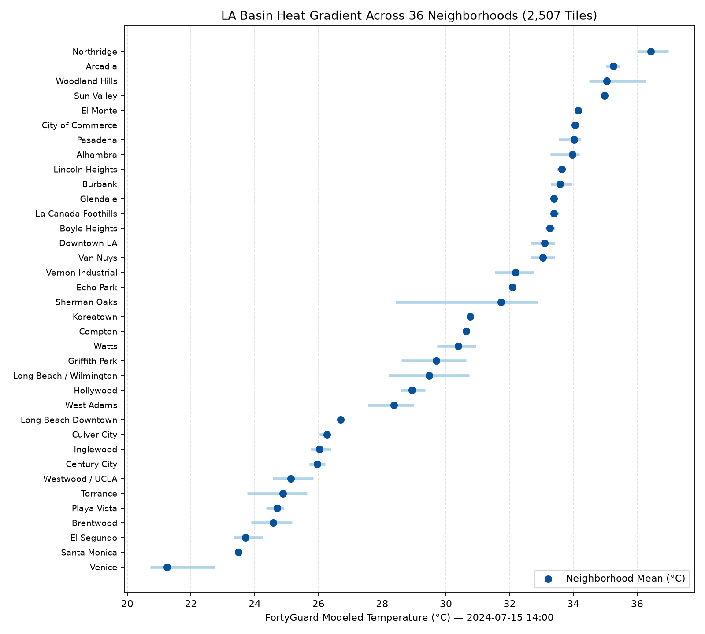
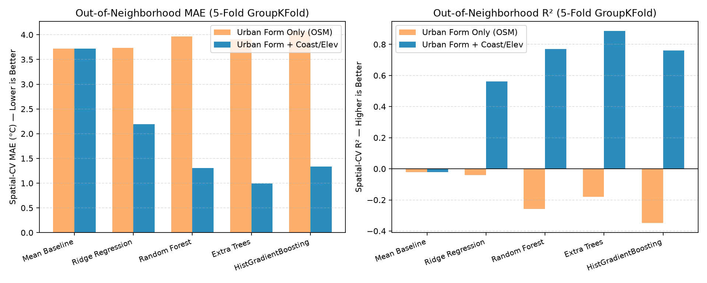
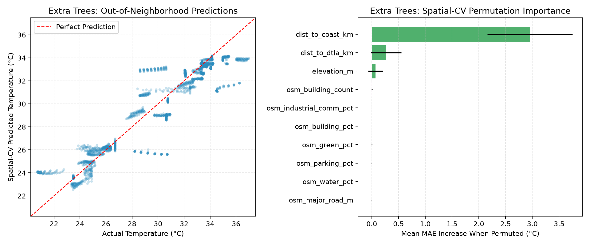

# FortyGuard Temperature API & MCP Evaluation Report

**Project:** Urban Heat Pattern Explorer  
**Evaluation Window:** November 17–19, 2026  
**Target Region & Snapshot:** Los Angeles Basin (`2024-07-15 14:00` local)  
**Account Tier:** `Premium` (`One-Time`, initial `1,000,000` credits; **`788,560` credits remaining** after Phases 1–4)

Every claim in this report is tagged by evidence type:
* **`[Documented]`** — Stated in FortyGuard's live web docs (`docs-api.fortyguard.com`) or MCP tool schemas.
* **`[Observed]`** — Directly measured in our timestamped, sanitized API/MCP logs or local Python runs.
* **`[Inferred]`** — Engineering or scientific conclusion drawn from observed behavior.
* **`[Not tested]`** — Explicitly out of scope or skipped to protect the trial credit budget.

---

## 1. Executive Summary

FortyGuard provides a rich geospatial thermal platform spanning point environmental lookups, 100m heatmaps, street/satellite land-cover segmentation, heat-aware routing, and heat-intelligence reports over both REST (`https://api.fortyguard.com`) and MCP (`https://tos-mcp.app.fortyguard.com/mcp`).

Across 30+ structured API/MCP tests and a **2,507-tile, 36-neighborhood** ML proof of concept in Los Angeles:
1. **Asynchronous REST vs. Synchronous MCP:** `[Observed]` All 6 REST `POST` endpoints return an asynchronous `activity_id` requiring polling via `GET /v1/status/{activity_id}`, whereas MCP wraps `env_params`, `satellite`, and `streetview` synchronously while keeping `heatmap` asynchronous (`heatmap` + `heatmap_read`).
2. **Credit Economics Drive Architecture:** `[Observed]` `POST /v1/heatmap` (`4,220` credits per ~0.8 km² box) yields ~72–81 labeled `100m × 100m` tiles (~55 credits/tile), making it **~260× cheaper per spatial observation** than `POST /v1/satellite` (`14,400` credits/point).
3. **Platform Friction Points:** `[Observed]` Intermittent upstream `503`/`504` timeout windows occurred across REST, MCP, and docs; `env_params` crashed with `HTTP 500` on invalid date/enum inputs; `satellite` `100m` failed with zero diagnostic reason (`0` credits); and units/schemas showed minor inconsistencies (°C vs °F, swapped streetview angle descriptions).
4. **ML Proof of Concept (`2,507` tiles):** `[Observed]` Under strict **5-fold Spatial GroupKFold** (holding out entire neighborhoods), **`Extra Trees`** predicts out-of-neighborhood temperature with **`MAE = 0.9900 °C` (`RMSE = 1.4114 °C`, `R² = 0.8858`)** when combining OpenStreetMap urban form with macro-geography (`dist_to_coast_km`, `dist_to_dtla_km`, `elevation_m`), versus `MAE = 3.7219 °C` for the Mean Baseline.

---

## 2. REST vs. MCP Evaluation

| Capability | REST (`api.fortyguard.com`) | MCP (`tos-mcp.app.fortyguard.com/mcp`) | Evidence |
| :--- | :--- | :--- | :--- |
| **Auth** | `api-key` header (+ body `api_key` on usage endpoint) | `Authorization: Bearer <key>` + `mcp-session-id` | `[Observed]` |
| **Execution Model** | Async `activity_id` + `GET /v1/status/{id}` on all 6 POSTs | Sync for `env_params`, `satellite`, `streetview`; async for `heatmap`, `report`, `routing` | `[Observed]` |
| **Cross-Interface Read** | `GET /v1/status/{id}` reads any job (REST or MCP) | `heatmap_read` reads REST-created `activity_id` (bounded stats, no GeoJSON) | `[Observed]` |
| **Tool / Endpoint Count** | 6 compute POSTs + status + key-usage | 11 MCP tools discovered via `tools/list` | `[Observed]` |

### Observed Endpoint Latency & Credit Cost
| Endpoint / Tool | Observed Latency | Credits Charged | Notes |
| :--- | :--- | ---: | :--- |
| `POST /v1/system/fetch-api-key-usage` | `< 1s` | `0` | `[Observed]` Echoes raw key in JSON (sanitized locally) |
| `POST /v1/env_params` | `3.4s` poll (`10.2s` submit) | `2,900` | `[Observed]` Requires caller-supplied `temperature` |
| MCP `env_params` | `8.45s` (sync) | `2,900` | `[Observed]` Exact numeric match to REST |
| `POST /v1/heatmap` (~0.8 km²) | `~21–33s` | `4,220` | `[Observed]` 72 tiles (DTLA), 81 tiles (Griffith Park) |
| `POST /v1/satellite` (`g=80, ft=3`) | `9.77s` | `14,400` | `[Observed]` `350×350` urban segmentation; `image_date: null` |
| `POST /v1/satellite` (`g=20, ft=3`) | `26.37s` | `14,400` | `[Observed]` `80×80` roof crop (`76.59% others`, `0.83% sea`) |
| `POST /v1/satellite` (`g=100`) | `~124s` (`Failed`) | `0` | `[Observed]` `status: "Failed"`, `error: false`, no reason |
| `POST /v1/streetview` | `14.82s` | `8,600` | `[Observed]` `image_date: 2026-06-01` |
| `POST /v1/routing` | `30.14s` | `3,500` | `[Observed]` Settled asynchronously after completion |
| `POST /v1/heat_intelligence` | `157.31s` | `8,600` | `[Observed]` Returns °F + redacted signed `download_link` |

---

## 3. Consolidated Findings (`F-01` – `F-11`)

* **F-01 `[Observed]` Intermittent Upstream Timeouts:** Transient `503 no healthy upstream`, `504 upstream request timeout`, and TLS timeouts occurred across REST, MCP, and `docs-api.fortyguard.com`. Controlled `curl` vs. Python A/B tests confirmed server-side origin.
* **F-02 `[Observed]` Usage Endpoint Key Echo:** `POST /v1/system/fetch-api-key-usage` requires `api_key` in the JSON body despite the `api-key` header and echoes it back; `src/client.py` redacts it automatically before saving.
* **F-03 `[Observed]` Unit Inconsistency:** `env_params` and `heatmap` return °C, whereas `heat_intelligence` returns °F even though its `date` field description mentions Celsius.
* **F-04 `[Observed]` `env_params` Cannot Serve as ML Target:** `POST /v1/env_params` requires the caller to pass `temperature` as an input parameter.
* **F-05 `[Observed]` Async REST vs. Sync MCP:** All 6 REST POST endpoints use async `activity_id` polling, while MCP wraps `env_params`, `satellite`, and `streetview` synchronously.
* **F-06 `[Observed]` Mixed AQI Key Naming:** Responses mix `air_quality:idx` and `aqi_us_co` conventions.
* **F-07 `[Observed]` Cross-Interface `heatmap_read`:** MCP `heatmap_read` successfully reads a REST-created `activity_id`, returning bounded summary stats without raw GeoJSON tiles.
* **F-08 `[Observed]` Silent `satellite` Failures:** `100m` `satellite` jobs returned `status: "Failed"` with `error: false`, `status_code: 200`, and no diagnostic error message (`0` credits charged).
* **F-09 `[Documented]` Schema/Doc Discrepancies:** REST docs vs. MCP schemas swap `vertical_angle`/`horizontal_angle` pitch/heading descriptions, and `limitations` specifies `FeatureCollection` while `create-heatmap` examples show bare `Polygon`.
* **F-10 `[Observed]` `satellite` Granularity Sensitivity:** `granularity=20` produced an `80×80` roof crop (`76.59% others`, `0.83% sea` in Downtown LA); `granularity=80` produced clean `350×350` urban segmentation, though `image_year` and `image_date` were `null`.
* **F-11 `[Observed]` Unhandled `500` on Bad Inputs:** Missing fields (`422`), out-of-range coordinates (`422`), and unclosed polygons (`400`) validated cleanly, but malformed date/enum (`2024-99-99`, `filter_type: 99`) triggered `HTTP 500`.

---

## 4. Phase 4 ML Proof of Concept: "Urban Heat Pattern Explorer"

### 4.1 Dataset & Reproducible Separation
* **API Test vs. ML Data Separation:** Phase 2/3 smoke tests remain in `data/raw/*.json`, while Phase 4 ML heatmaps live in `data/raw/phase4_heatmaps/` with `manifest.json` explicitly tracking provenance (`34` new neighborhoods + `2` reused `2024-07-15 14:00` heatmaps = **`36` neighborhoods, `2,507` tiles**).
* **Zero-Credit GIS Enrichment:** `src/build_gis_features.py` clipped OpenStreetMap features (`osm_building_pct`, `osm_building_count`, `osm_road_length_m`, `osm_major_road_m`, `osm_green_pct`, `osm_water_pct`, `osm_industrial_comm_pct`, `osm_residential_pct`, `osm_parking_pct`) to every 100m tile and added `dist_to_coast_km`, `dist_to_dtla_km`, and Open-Meteo `elevation_m` → `data/processed/urban_heat_tiles.csv` (`2,507 × 24`, `0` missing values).
* **Temperature Gradient:** `[Observed]` `20.72 °C` (Venice) to `36.99 °C` (Northridge), mean `30.08 °C`, std `4.18 °C`.

### 4.2 Spatial Leakage Proof (`KFold` vs. `GroupKFold`)
`[Observed]` Evaluating `ExtraTreesRegressor` with a naive random 5-fold split leaks neighboring 100m tiles across train and test, severely understating true generalization error:
* **Random 5-Fold KFold (Leaky):** `MAE = 0.0952 °C`, `RMSE = 0.1572 °C`, `R² = 0.9986`
* **Spatial 5-Fold GroupKFold (Honest, by neighborhood):** `MAE = 0.9900 °C`, `RMSE = 1.4114 °C`, `R² = 0.8858`

### 4.3 Spatial-CV Model Comparison (5-Fold `GroupKFold`)

| Feature Set | Model | Spatial MAE (°C) | Spatial RMSE (°C) | Spatial $R^2$ |
| :--- | :--- | ---: | ---: | ---: |
| **Urban Form Only** (9 OSM) | Mean Baseline | 3.7219 | 4.2184 | -0.0203 |
| **Urban Form Only** (9 OSM) | Ridge Regression | 3.7327 | 4.2593 | -0.0402 |
| **Urban Form Only** (9 OSM) | Extra Trees | 3.9085 | 4.5342 | -0.1788 |
| **Urban Form Only** (9 OSM) | Random Forest | 3.9680 | 4.6824 | -0.2572 |
| **Urban Form Only** (9 OSM) | HistGradientBoosting | 4.0657 | 4.8498 | -0.3487 |
| **Urban Form + Macro-Geo** (12) | Ridge Regression | 2.1889 | 2.7639 | 0.5620 |
| **Urban Form + Macro-Geo** (12) | HistGradientBoosting | 1.3390 | 2.0437 | 0.7605 |
| **Urban Form + Macro-Geo** (12) | Random Forest | 1.3055 | 2.0039 | 0.7697 |
| **Urban Form + Macro-Geo** (12) | **Extra Trees** | **0.9900** | **1.4114** | **0.8858** |

### 4.4 Physical Drivers, Residuals & Within-Neighborhood Check
* **Dominant Driver:** `[Observed]` `dist_to_coast_km` is overwhelmingly the #1 predictor (`+2.9559 °C` permutation MAE penalty in `Extra Trees`; `+3.505 °C` per 1 SD in `Ridge`). Once coastal distance is controlled for, `Ridge` recovers physically expected local effects: `osm_green_pct` (`-0.401 °C` per 1 SD), `osm_parking_pct` (`+0.250 °C`), and `osm_major_road_m` (`+0.123 °C`).
* **Hardest Neighborhoods:** `[Observed]` Unique coastal-industrial or extreme microclimates had the highest Spatial-CV errors: `Long Beach / Wilmington` (`MAE = 3.760 °C`), `Woodland Hills` (`3.649 °C`), `Griffith Park` (`3.298 °C`), `Venice` (`2.777 °C`), and `Northridge` (`2.575 °C`).
* **Within-Neighborhood Anomaly (`temp_anomaly_c`):** `[Observed]` Subtracting each neighborhood's mean leaves a local spread of only `std = 0.3544 °C`, and OSM features alone do not beat the `Mean Baseline` (`MAE = 0.2155 °C`, `R² = 0.0000` vs. Ridge `R² = -0.0113`). `[Inferred]` FortyGuard's `100m` `tcm` heatmap primarily captures smooth neighborhood/meso-scale thermal gradients rather than sharp building-level microclimates.

---

## 5. Limitations & `[Not tested]` Scope

* **`[Not tested]` Temporal & Seasonal Generalization:** All `2,507` tiles reflect a single summer afternoon timestamp (`2024-07-15 14:00`).
* **`[Not tested]` Cross-City Transfer:** Trained and evaluated only within the Los Angeles Basin.
* **`[Not tested]` Multi-Point `satellite` vs. OSM Benchmark:** Intentionally skipped in Phase 4 to preserve `788,560` credits (API behavior of `/v1/satellite` was already established in Phase 2).
* **`[Not tested]` `monitoring` & `report_read` Execution:** Discovered in MCP `tools/list` but not executed to avoid recurring background credit charges.

---

## 6. Reproducibility & Repository Artifacts

* **Notebooks:** `notebooks/01_api_exploration.ipynb`, `notebooks/02_dataset_build.ipynb`, `notebooks/03_ml_prototype.ipynb`
* **Scripts:** `src/collect_phase4_heatmaps.py`, `src/build_gis_features.py`, `src/train_ml_prototype.py`
* **Processed Data:** `data/processed/urban_heat_tiles.csv`, `data/processed/ml_results_summary.json`
* **Security:** `.env` and `data/raw/osm_cache/` are gitignored; zero API keys, `subscription_id`s, or signed URLs are committed.
